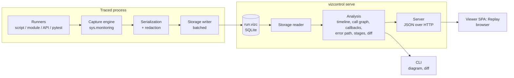

# Architecture

## Overview

VizControl is one Python package with two halves that only share a file format:

- **Capture side**, which runs inside the traced process: runners, the capture engine, serialization and the
  storage writer. It depends only on the stdlib.
- **Exploration side**, which runs after (or beside) the traced process: storage reader, analysis, local
  server and the browser viewer.

The `.vizc` file ([trace format](03-trace-format.md)) is the only contract between the halves (NFR-DEC-1).
Anything that can produce a valid `.vizc` file, such as a future `settrace` backend, another runtime or a
remote collector, gets the whole exploration side for free.



## Components

| Component | Responsibility | Doc |
|---|---|---|
| Runners | Start the user's code under capture with unchanged semantics; decide run boundaries and the outcome. Includes the pytest plugin and the ASGI/WSGI middleware (one run per request). | [runners.md](components/runners.md) |
| Capture engine | Register `sys.monitoring` callbacks, apply filters, keep a shadow call stack, emit events. | [capture.md](components/capture.md) |
| Serialization | Turn live objects into bounded, side-effect-free, redacted values with object ids. | [serialization.md](components/serialization.md) |
| Storage | Write events to SQLite in batches; read them back with an indexed query API. | [storage.md](components/storage.md) |
| Analysis | Pure functions over stored data: the replay timeline, call graph and inferred callbacks, watches, error path, object history; stages, run diff and search for the CLI and the API. | [analysis.md](components/analysis.md) |
| Server | Serve the viewer's static files and a read-only JSON API over one or more `.vizc` files. | [server.md](components/server.md) |
| Viewer | One view, Replay: the run as a recording (call graph by module, transcript, timeline, watches, callbacks). | [viewer.md](components/viewer.md) |
| CLI | `vizcontrol run`, `serve`, `ls`, `info`, `diagram`, `diff`; config loading. | [cli.md](components/cli.md) |

## Package layout

```
pyproject.toml                  hatchling; build hook copies the built viewer into the package
src/vizcontrol/
  __init__.py                   public API: trace(), traced, Config
  config.py                     Config dataclass + [tool.vizcontrol] loading
  capture.py                    Tracer (sys.monitoring), filters, shadow stack
  serialize.py                  value encoder, object ids, redaction
  store.py                      schema DDL, Writer, Reader
  runners.py                    run_script, run_module, trace() context manager, traced decorator
  pytest_plugin.py              pytest11 entry point (opt-in with --vizcontrol)
  web.py                        ASGIMiddleware / WSGIMiddleware: one scoped run per HTTP request
  analysis.py                   timeline, call graph, callbacks, watch, error path, object flow; stages, diff, search
  diagram.py                    stages as Mermaid flowcharts (`vizcontrol diagram`)
  server.py                     http.server-based API + static files
  cli.py                        argparse entry point `vizcontrol`
  viewer/static/                built SPA (generated, not edited by hand)
frontend/                       viewer source: TypeScript + React + React Flow + elkjs, built with Vite
  src/ReplayView.tsx            the one view; App.tsx is the shell (runs list), Inspector.tsx the value panel
  e2e/                          puppeteer smoke test over the ETL example
examples/etl/                   a layered ETL to try it on
tests/
docs/
```

Modules start as single files and are split only when they grow past one clear responsibility.

## End-to-end flow of one run

1. `vizcontrol run app.py --x 1` loads the config (CLI flags > `pyproject.toml` > defaults) and creates
   `.vizcontrol/runs/<timestamp>-app.vizc`.
2. The runner opens a `Writer`, writes run metadata, installs the `Tracer` and executes `app.py` as
   `__main__` with `sys.argv = ["app.py", "--x", "1"]`.
3. For every code object the first time it runs, the tracer checks the filters once. Excluded code objects get
   `sys.monitoring.DISABLE`, so they cost almost nothing afterwards (NFR-PERF-1).
4. Included calls push onto the tracer's shadow stack and produce `call` rows. At the configured level,
   args, return values and locals are serialized, redacted and attached.
5. Events are buffered and flushed in transactions every N events or T ms. An `atexit` hook and signal handlers
   flush on shutdown; an abrupt kill leaves an `unfinished` run with everything flushed so far (FR-PER-4).
6. The program ends; the runner records the outcome and exit code and closes the file. The program's own exit
   code is propagated.
7. `vizcontrol serve` (or `run --serve`) starts the server on `127.0.0.1` and opens the browser. The viewer asks
   for the run list, the call graph and the first page of the timeline (500 steps at a time, more as the user
   moves), and for the call stack, values and watches of the step on screen. A failed run opens on its raise.

## Key decisions

| Decision | Choice | Why | Revisit when |
|---|---|---|---|
| Tracing API | `sys.monitoring` (PEP 669) only | Per-code-object disabling gives near-zero cost for excluded code, and there is no global `settrace` conflict with debuggers/coverage (tool id). | Users need Python < 3.12: add a `settrace` backend that emits the same events. |
| Minimum Python | 3.12 | Required by `sys.monitoring`. | Same as above. |
| Trace storage | One SQLite file per run (`.vizc`) | Stdlib, single file to share, indexed queries for slices/search/diff without loading everything, crash-tolerant with WAL. | Very large runs need columnar storage. |
| Viewer | Static SPA prebuilt into the wheel | Rich graph interaction (React Flow, elkjs) that a Python UI can't match; users still only `pip install`. | — |
| What the viewer shows | One recording view (0.4) instead of zoom levels | Users understood a run by watching it happen (who calls whom, when, with what), not from structure diagrams. | Structure is wanted again: the stage analysis is still in the API and `vizcontrol diagram`. |
| Server | stdlib `http.server` (threaded) | Zero dependencies, local and single-user, read-only. | Live streaming or many concurrent clients. |
| Analysis location | Python, server side, on demand | One implementation, testable with pytest, viewer stays a thin renderer. Results cached per file. | Latency on huge runs, then precompute into the `.vizc` file at close. |
| Value capture | Structural encoder, no `__repr__` by default | Calling user code from a tracer can mutate state, recurse into tracing or hang (NFR-SAFE-1). | — |
| AI | None | Runtime evidence is the source of truth (NFR-AI-1). | Optional plugin reading `.vizc` only. |

## Cross-cutting concerns

- **Provenance (NFR-OBS)**: capture writes only observed facts. Rows that represent gaps (opaque calls,
  truncation, redaction) carry an explicit marker. Analysis results are tagged `inferred` in API responses.
  In the viewer, library calls (not observed inside) are dashed boxes and inferred callbacks are labelled
  "inferred" and drawn as dashed edges.
- **Tracer safety**: every callback is wrapped so that an internal error disables VizControl, logs one warning to
  stderr and lets the program continue. The tracer never raises into user code.
- **Re-entrancy**: the tracer sets a thread-local "inside VizControl" flag while serializing or writing, so its own
  calls are never traced.
- **Versioning**: `vizcontrol.__version__` and a separate `format_version` in each `.vizc`. The server can read
  all files with the same major format version.
